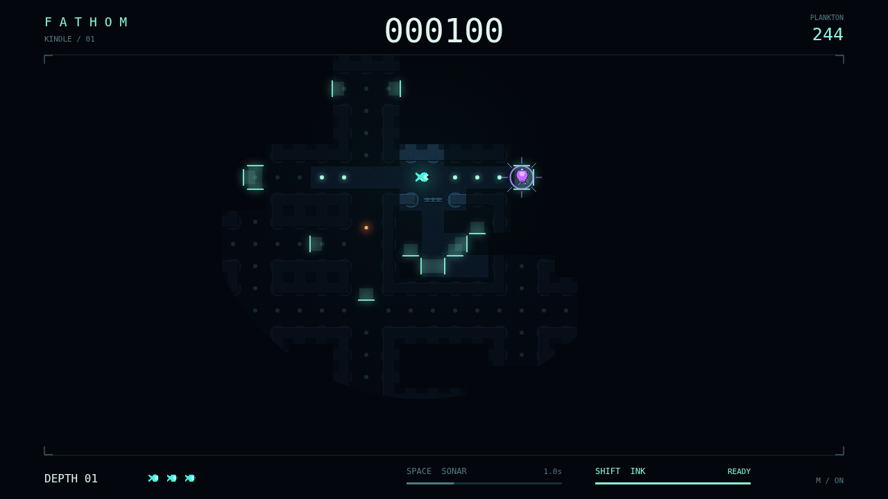

# Fathom

You are a small light in a sea that would rather stay dark. Swim the flooded
corridors, graze the glowing plankton, and find your way through a maze you can
only see in pieces. Eat every last mote to clear the depth and descend again.

Your light remembers the stone it touches. Your circular window grows as you
feed, opening a little more of the abyss—then letting it close behind you as
you dim. A sonar pulse runs around corners and finds passages your light cannot.
Sometimes it finds something waiting there, too.

The Lanternjaw follows your glow, hiding beneath the same amber bell as a
harmless drifter. The Gloamfin has no need of eyes; it listens, and your own
sonar can hand it your position. The Flarefish breaks the darkness with a bloom
that sees straight through rock. Ink buys space against the hunters that see.
Against the one that hears, you will need a better route.

Every dive is a balance between feeding and giving yourself away. Take a risk
on an amber glimmer, turn before the hunter closes, and keep a little darkness
between you and the next depth. A catch costs a reserve life, not the paths you
have learned. The deeper you go, the more hunters the sea lets loose.

